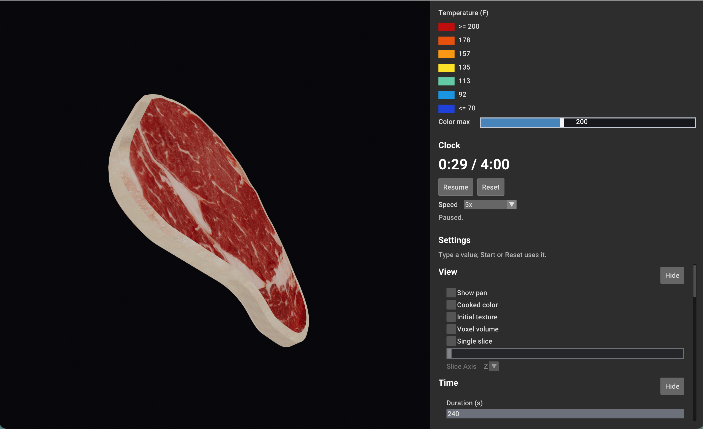
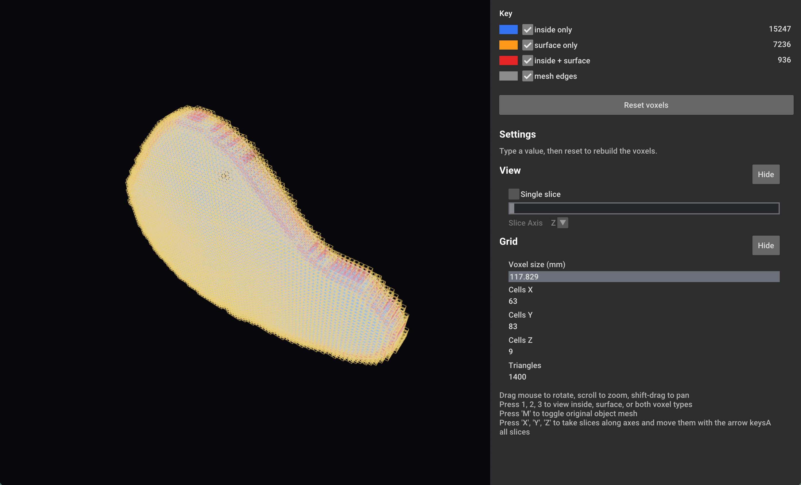
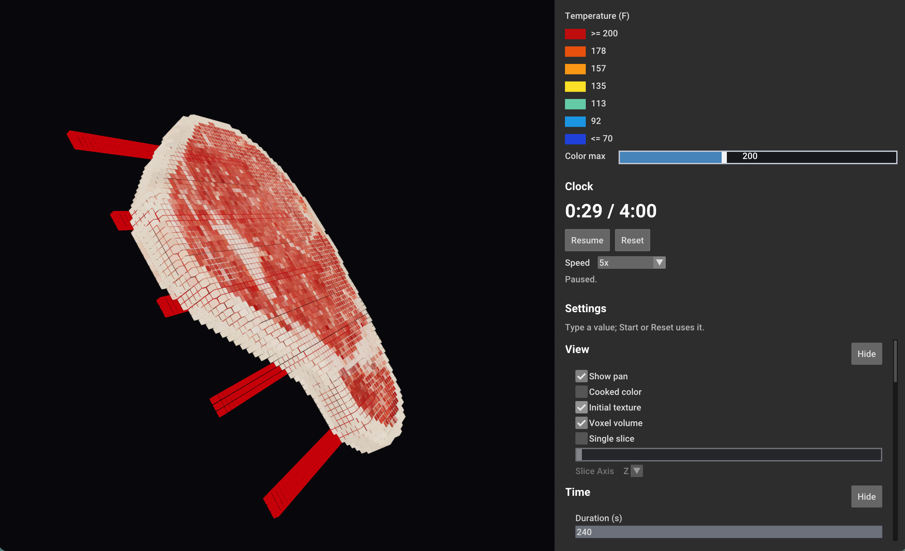
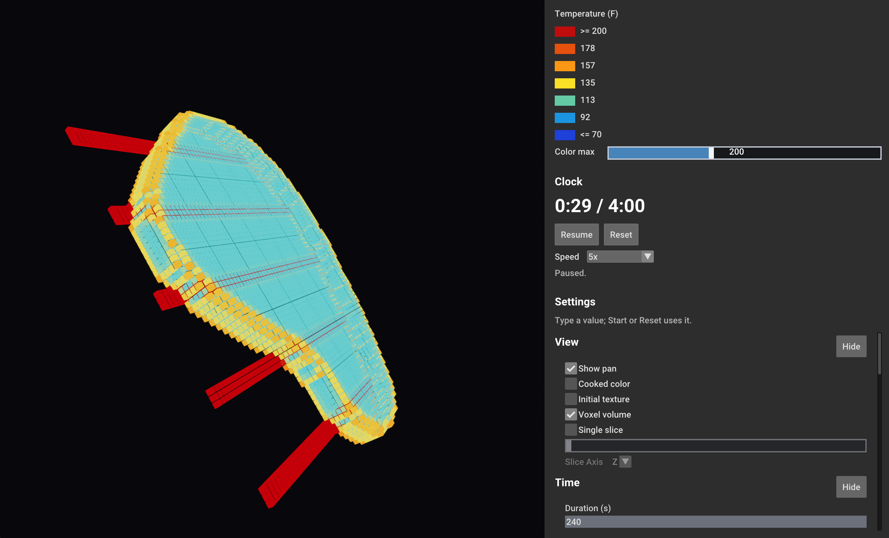
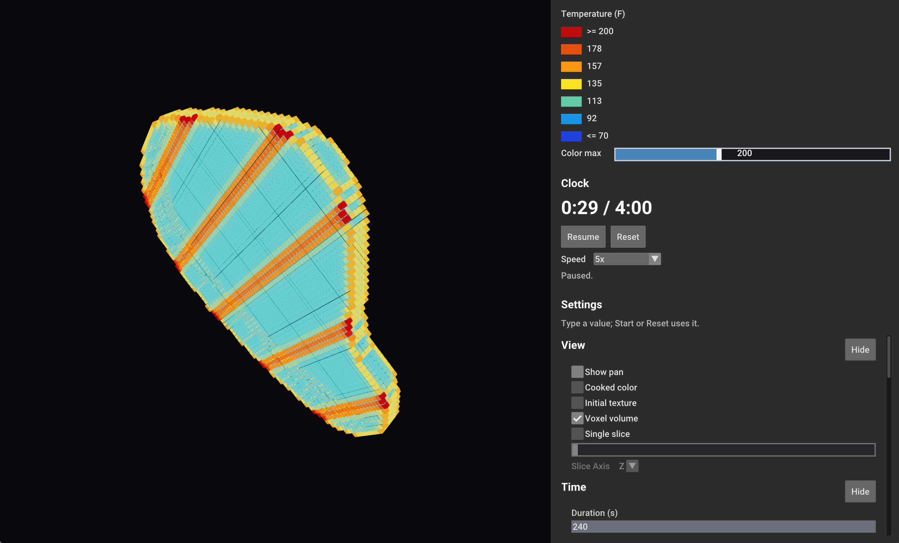
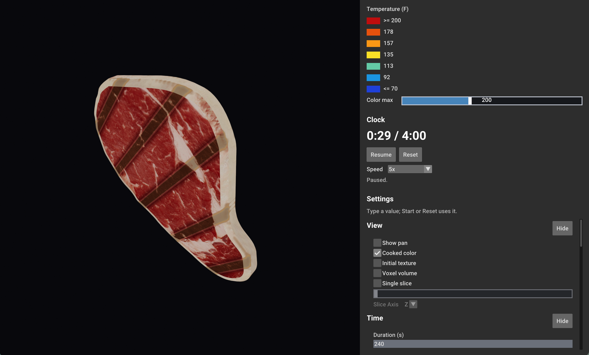

# steak-sim

GPU heat diffusion for steak cooking, with Vulkan visualization.

A steak mesh is voxelized on the GPU into a grid of inside/surface flags; that grid is the domain for a finite-difference heat simulation. Rendering and compute both run on Vulkan, with shaders written in Slang.

## Stack

- **C++20** host code
- **Vulkan 1.3+** for rendering and compute; **Slang** (`slangc`) for shaders
- **GLFW** for the main window, **Open3D** for the voxel debug viewer
- **CMake** build system, **GoogleTest** for tests

## Layout

```
src/
  assets/      one folder per asset, e.g. steak1/ (steak.obj + textureSteak.jpeg)
  shaders/
    render/    graphics shaders
    compute/   compute shaders (voxelizer, heat diffusion)
  sim/         simulation code: voxelizer, headless compute context
  render/      steak_sim app and voxel_viewer
tests/         GoogleTest suites and their test shaders
```

## Build

```bash
cmake -S . -B build
cmake --build build -j
```

Executables are written directly to `build/`, compiled shaders to `build/shaders/`. Shader and asset paths are baked in at build time, so the executables can run from any directory.

| Executable | Purpose |
|------------|---------|
| `build/steak_sim` | Main Vulkan app: renders the steak and voxelizes it |
| `build/voxel_viewer [model.obj] [voxelSize]` | Draws the voxel grid as box outlines with a color key |
| `build/steak_heat_demo [model]` | Cooks the steak on a pan and shows the temperature, cooked color, and textured mesh |
| `build/steak_heat_live [model]` | The same cook played on a clock: Start, Pause, Reset, adjustable speed |
| `build/steak_grill_live [model]` | `steak_heat_live` on a grill: 5 bars at the pan temperature instead of a solid pan |
| `build/voxel_tests` | Unit tests for the voxelizer and its shader math |

Options: `-DSTEAK_ASSET=<folder>` picks which `src/assets/` folder is loaded (default `steak1`); `-DSTEAK_BUILD_RENDER=OFF` skips the GLFW/Open3D executables; `-DSTEAK_BUILD_TESTS=OFF` skips the tests.

## Test

```bash
ctest --test-dir build
```

## Roadmap

- [x] Finite-difference heat diffusion over the voxel grid
- [ ] Volume ray-marching shader for full 3D steak texture
- [ ] Steak albedo texture blended with temperature colormap
- [ ] Boundary conditions for pan contact and ambient cooling

## Pipeline Samples (With a grilling example)
Initial model load/render:



Model undergoes conservative voxelization:



Model texture is sampled to 3D texture image:



Model voxels go under 3D FDM to solve Heat Diffusion; 3D texture image is updated with new colors at each step




3D texture image is sampled in the final render




